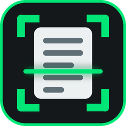

<p align="center">
  
</p>

<h1 align="center">OCR Aracı</h1>

<p align="center">
  Görsellerdeki metni <b>tamamen yerel</b> olarak okuyan, Türkçe karakterlere önem veren Windows masaüstü uygulaması.<br>
  Verileriniz bilgisayarınızdan çıkmaz: bulut servisi, hesap ya da API anahtarı gerekmez.
</p>

---

## Neler yapar?

Ekran görüntüsü, belge fotoğrafı, şema ya da kart gibi görselleri yükleyin; **Metni Ayrıştır** deyin, metin sağ panelde düzenlenebilir şekilde belirir.

- **İki OCR motoru, tek tıkla seçim:** EasyOCR (derin öğrenme, ekran görüntüleri ve karışık düzenlerde güçlü) ve Tesseract (hızlı, düz metin belgelerinde güçlü). Dil: Türkçe + İngilizce, yalnız Türkçe ya da yalnız İngilizce.
- **Üç tarama modu:**
  - *Düz Metin (Satır Satır)*: kitap/makale gibi tek akışlı belgeler.
  - *Bölgesel / Şema (Blok Blok)*: çok sütunlu sayfalar, kartlar ve şemalar; metin kutularını bloklara ayırıp okuma sırasına dizer (`[1. Bölge]`, `[2. Bölge]`...).
  - *Seçili Alanlar (Çoklu Bölge)*: görselde sizin çizdiğiniz alanları sırayla okur.
- **Okumadan önce görüntü iyileştirme:** kontrast (CLAHE), gürültü temizleme, gri tonlama, adaptif ikilileştirme, **eğik belge düzeltme (deskew)** ve MS Paint gibi araçlarla çizilmiş **renkli çizik/şekilleri silip altındaki harfleri onarma**. Koyu tema ekran görüntüleri de desteklenir.
- **Tıklanabilir metin kutuları:** tanınan her kelime/ifade görselin üzerinde çerçevelenir; bir kutuya tıklamak o metni panoya kopyalar.
- **Çıktı:** metni kopyalayın ya da **TXT, Word (.docx) ve PDF** olarak kaydedin (bölge etiketleri dosyaya yazılmaz).
- **Koyu tema arayüz**, sürükle-bırak ile görsel yükleme, `Ctrl` + fare tekerleği ile yakınlaştırma, `Shift` ile çoklu bölge seçimi.
- **Uygulama içi güncelleme:** yeni sürüm yayınlandığında Yardım menüsünden ya da açılışta bildirilir; indirilen dosya SHA-256 ile doğrulanır.

## Kurulum (Windows)

1. [Releases](https://github.com/Yusufygc/OCR_Araci/releases) sayfasından en son `OCRAraci-Setup-X.Y.Z.exe` dosyasını indirip çalıştırın. Yönetici izni istemez.
2. **Tesseract motorunu kullanacaksanız** [Tesseract-OCR](https://github.com/UB-Mannheim/tesseract/wiki)'i ayrıca kurun (Türkçe dil paketiyle). EasyOCR modelleri ilk kullanımda indirilir, bu yüzden ilk çalıştırmada internet gerekir.

> Kurulum dosyası **imzasızdır**. SmartScreen uyarısında "Ek bilgi" > "Yine de çalıştır" seçin. Windows 11 Akıllı Uygulama Denetimi açıksa dosyayı engelleyebilir; bu durumda birkaç dakika sonra aynı dosyayı yeniden çalıştırın.

## Kaynaktan çalıştırma

Gereksinimler: Python 3.10, (isteğe bağlı) Tesseract.

```powershell
python -m venv venv
.\venv\Scripts\activate
pip install -r requirements.txt
python src/main.py
```

Testler:

```powershell
python -m unittest discover tests
```

Kurulum dosyası üretmek (Inno Setup 6 ve `requirements-build.txt` gerekir):

```powershell
pip install -r requirements-build.txt
python build_installer.py
```

## Teknoloji

Python 3.10 · PySide6 (Qt) · OpenCV · EasyOCR / PyTorch · Tesseract (pytesseract) · python-docx · PyInstaller · Inno Setup · GitHub Actions

## Mimari özeti

```
src/
  core/        OCR motorları (Strategy + Factory), tarama stratejileri, yerleşim analizi, görüntü işleme
  ui/          PySide6 arayüzü: ana pencere, tuval, filtre paneli, kutu katmanı, güncelleme penceresi
  utils/       dışa aktarıcılar (TXT/DOCX/PDF) ve güncelleme çekirdeği
  main.py      uygulama girişi
packaging/     kararlı exe girişi, Inno Setup betiği, uygulama ikonu
tests/         birim ve arayüz testleri
docs/wiki/     proje bilgi tabanı (mimari, kararlar, dağıtım, günlük)
```

Motorlar ve tarama modları `IOCREngine` / `IScanStrategy` arayüzleriyle takılıp çıkarılabilir; yeni bir motor ya da mod eklemek için fabrikaya kayıt yeterlidir.

## Belgeler

Ayrıntılı bilgi `docs/wiki/` altındadır; başlangıç noktası [`docs/wiki/index.md`](docs/wiki/index.md):

- [Mimari](docs/wiki/architecture.md) · [OCR motorları](docs/wiki/ocr_engines.md) · [Görüntü işleme](docs/wiki/image_processing.md) · [Arayüz](docs/wiki/ui_system.md) · [Dışa aktarma](docs/wiki/exporters.md)
- [Dağıtım](docs/wiki/deployment.md) · [Kararlı exe ve Akıllı Uygulama Denetimi](docs/wiki/exe_distribution.md) · [Sürüm yayınlama](docs/wiki/release_process.md) · [Uygulama içi güncelleme](docs/wiki/update_system.md)

## Bilinen sınırlar

- Yalnızca Windows için paketlenmiştir (kaynak kod diğer sistemlerde de çalışabilir, test edilmedi).
- Varsayılan açık kontrast (CLAHE) filtresi Tesseract ile şema görsellerinde metni silebilir; şemalarda filtreleri kapatın ya da EasyOCR kullanın. Adaptif ikilileştirme koyu ve fotoğraflı arayüzlerde okumayı bozabilir.
- OCR doğruluğu görsel kalitesine bağlıdır; çok küçük, bulanık ya da el yazısı metinlerde sonuçlar düşer.
